# ChunkForge: phase 0 → 14, with real records

Start with [the visual atlas](PROJECT_ATLAS.html), then use this searchable guide.
API details: [API_FLOWS](API_FLOWS.md). Operations: [OPERATIONS](OPERATIONS.md).
Architecture decisions: [DESIGN_DECISIONS](DESIGN_DECISIONS.md).
Interview defense: [INTERVIEW](../INTERVIEW.md). Honest boundaries: [GAP_AUDIT](GAP_AUDIT.md).

## One system, two lifecycles

```mermaid
flowchart LR
    subgraph INGEST["Document lifecycle — background"]
        RAW["arXiv / new PDF"] --> PARSE["Parse → clean text + provenance"]
        WATCH["New-file watcher"] --> KAFKA["Kafka metadata event"]
        KAFKA --> WORKER["Consumer / PDFProcessor"] --> PARSE
        PARSE --> CHUNK["Five chunk strategies"] --> EMB["BGE embeddings"]
    end
    EMB --> PG[("PostgreSQL / pgvector + run manifests")]
    subgraph QUERY["Question lifecycle — synchronous"]
        UI["Angular / curl"] --> API["FastAPI DTO + capacity gate"]
        API --> CACHE[("Redis query embedding cache")]
        CACHE --> DENSE["BGE on miss → cosine search"]
        API --> BM25["BM25 over source snapshot"]
        DENSE --> RRF["RRF → cross-encoder → top5"]
        BM25 --> RRF
        RRF --> SEARCH["/search: evidence"]
        RRF --> PACK["/ask: bounded prompt"] --> OLLAMA["Local Llama via Ollama"]
        OLLAMA --> CHECK["Validate / cite / abstain / degrade"] --> UI
    end
    PG --> DENSE
    PG --> BM25
    SEARCH --> UI
```



Arrows are dependencies/data movement, not a promise of parallel execution.
Our code performs BM25 before the protected dense call. PostgreSQL can be read
before Redis for manifest/snapshot checks. There is no query→Kafka→answer queue.

## The main question and source

**How does DivOPD select turns for training?** Source document: `2609.34838v1`.
The original PDF, cleaned text, indexed chunk, vector and generated answer are
different representations—not the same object moving unchanged through services.

### Phase 0 — Reproducible environment

`pyproject.toml` declares Python dependencies/tools; `uv.lock` locks resolved
versions; uv creates `.venv`. This is analogous to Maven coordinates + dependency
resolution, not a compiled JAR. Python source is interpreted by its runtime.
`config.py` loads typed `CHUNKFORGE_*` settings, like `@ConfigurationProperties`.
`.env.example` is a safe template; ignored `.env` is the local configuration.

Dockerfile.api is the **recipe**. `docker build` produces an image (filesystem
layers + runtime metadata). A container is a running/created instance of that
image, like starting a JVM process from a packaged application—not “a port.”
Compose names services, images/build context, environment, networks and volumes.
The API image includes Python; a host-run API needs host Python, a container-run
API doesn't. Redis/Kafka/Ollama images bring their own needed runtimes, not our
FastAPI source. This is Docker Desktop, **not Kubernetes**.

Host API connects to localhost:5433; a Compose API connects to postgres:5432.
`postgres` is another container's DNS name, not PostgreSQL inside the API container.
Named volumes outlive ordinary `compose down`; they are not independent backups.
CI means automated build/lint/type/test checks on pushes, not application hosting.

### Phase 1 — PDF → source text

Downloader fetches arXiv metadata/PDFs politely, records source identity/hash,
uses temporary writes and can resume. Parser orders text blocks, removes repeated
margins/page numbers conservatively and records page character spans. Headers,
two columns, tables and hyphenation can corrupt retrieval before models start.

Actual run: 200 PDFs, 5,666 pages, 18,142,649 clean characters, 90,713.2 average
characters/document. Only 75 are selected for vector indexing. These aren't
200 questions or 200 chunks. Parsing isn't OCR: image-only pages and semantic
table reconstruction remain gaps. Provenance means source identity/location is
preserved so an answer can be audited back to evidence.

### Phase 2 — Text → five sets of source spans

A token is a tokenizer-defined unit: punctuation, word, fragment or whitespace.
Tokenization maps text to integer IDs. The real main question under tiktoken
`cl100k_base` produces:

```json
[4438, 1587, 8940, 3143, 35, 3373, 10800, 369, 4967, 30]
```

Those are **10 tiktoken units**, not the BGE or Llama token sequence. Each model's
vocabulary differs. A context window is that model's maximum simultaneously
processed token input/output capacity; it is not “one PDF” or a storage limit.
The BGE backend subdivides input into safe model windows instead of silently
assuming a 512-tiktoken chunk always fits a 512-BGE-token input.

Why chunk? A whole-paper vector blends unrelated topics; narrow source spans
improve specificity and fit bounded model inputs. Too small loses context; too
large dilutes relevance. Overlap repeats boundary context but adds duplicate
storage/candidates. These five are selected strategies, not all known strategies.

| Strategy        | Mechanism                                                         | Wins / loses                                                           | Actual DivOPD chunks in five-paper comparison |
| --------------- | ----------------------------------------------------------------- | ---------------------------------------------------------------------- | --------------------------------------------: |
| fixed           | Bounded token windows,512 budget,50 overlap                       | Simple baseline / cuts structure                                       |                                            54 |
| recursive       | Refine paragraph/sentence boundaries then pack                    | Preserves structure / depends on parser/boundaries                     |                                            55 |
| semantic        | Adjacent sentence embedding similarity breakpoints                | Topic transitions / extra inference, threshold sensitivity             |                                           163 |
| sentence_window | Index sentence anchor, carry ±1 surrounding context               | Precise anchors / many rows, expansion must be used deliberately       |                                           895 |
| late            | Contextualize bounded passage first; mean-pool core token vectors | Context-aware cores / bounded context, different 128-token core budget |                                           221 |

These are historical measured chunk statistics, not quality scores. Avg core
tokens = mean size of indexed cores. Max core tokens = largest observed core,
not the model context window. Sentence context can exceed core size. Late chunking
here is **passage-local**, not whole-paper contextual encoding. Generation currently
uses core text rather than sentence-window expansion. Both are explicit limits.

Actual stored record, main question's supporting chunk:

```json
{
  "doc_id": "2609.34838v1",
  "strategy": "recursive",
  "chunk_index": 3,
  "char_start": 6901,
  "char_end": 8682,
  "token_count": 359,
  "representation": "bounded_piece_mean"
}
```

Text starts “We therefore introduce DivOPD...” and describes filtering unusable
supervision, limiting each rollout's contribution and selecting disagreement-rich
turns. Offsets use Python Unicode code points, end-exclusive. Java String uses
UTF-16 code units; don't assume offsets transfer unchanged to Java/JS slicing.

### Phase 3 — Source spans → normalized vectors → vector index

An embedding is a learned numeric representation, not encrypted text or a truth
score. BGE returns 384-dimensional vectors. A bi-encoder encodes query and document
separately; stored document vectors can be reused. Query input receives the model's
retrieval instruction. CPU inference uses pretrained weights without gradients;
we're not training or fine-tuning the model.

#### Inside the encoder: text isn't sent directly to HNSW

The cached BGE tokenizer was run locally on this exact prepared input:

```text
Represent this sentence for searching relevant passages: How does DivOPD select turns for training?
```

It produced 20 tokens including special markers, unlike the 10 tiktoken units for
the original question alone:

```json
{
  "tokens": [
    "[CLS]",
    "represent",
    "this",
    "sentence",
    "for",
    "searching",
    "relevant",
    "passages",
    ":",
    "how",
    "does",
    "di",
    "##vo",
    "##pd",
    "select",
    "turns",
    "for",
    "training",
    "?",
    "[SEP]"
  ],
  "input_ids": [
    101, 5050, 2023, 6251, 2005, 6575, 7882, 13768, 1024, 2129, 2515, 4487,
    6767, 17299, 7276, 4332, 2005, 2731, 1029, 102
  ],
  "attention_mask": [
    1, 1, 1, 1, 1, 1, 1, 1, 1, 1, 1, 1, 1, 1, 1, 1, 1, 1, 1, 1
  ],
  "input_shape": [1, 20],
  "configured_hidden_size": 384
}
```

`##` marks a WordPiece continuation; `DivOPD` becomes several vocabulary pieces.
`[CLS]` and `[SEP]` are model-format markers, not source evidence. The attention
mask identifies actual input versus batch padding; this single unpadded query has
all ones. It isn't a word-importance or relevance score.

| Internal step         | Representation                                                   | Java analogy                                                    |
| --------------------- | ---------------------------------------------------------------- | --------------------------------------------------------------- |
| Tokenizer             | Integer IDs/masks, shape `[batch=1,tokens=20]`                   | Converting a DTO into the compute engine's array input contract |
| Transformer inference | Contextual token features; expected shape `[1,20,384]`           | Calling a prebuilt compute engine, not executing SQL            |
| Model pooling         | Standard BGE sentence representation uses configured CLS pooling | Reducing per-token output to one record                         |
| Oversized input       | Encode safe pieces, average vectors, normalize                   | Explicit bounded batches + aggregation, not silent truncation   |
| Final vector          | 384 floating-point coordinates, normalized                       | Typed numeric DTO for vector search/cache                       |

The tensor shape is architecture-derived, not a claim every intermediate float
tensor was captured. The final vector below was actually read from Redis. Late
chunking instead takes contextual per-token vectors and mean-pools positions in
each selected core. Neither path changes weights; `inference_mode` disables
training-gradient bookkeeping.

Actual main-question query vector, first six of 384 coordinates:

```json
[
  -0.0801944053, -0.0352666374, 0.0565881499, 0.0026149484, -0.063481807,
  0.0251936854
]
```

No single coordinate means “training” or “DivOPD.” Meaning is distributed.
L2 normalization divides by vector length. Cosine compares direction: for
`[1,0]` and `[1,1]`, score is about 0.707; this tiny arithmetic example isn't a
real BGE output. Unit-vector dot product equals cosine. pgvector cosine distance
is `1 - cosine similarity`; smaller distance means closer direction.

PostgreSQL stores text/metadata/vector/model identity; HNSW is a navigable graph
index for approximate nearest neighbors—like a DB index for semantic proximity.
Approximate means it can miss exact nearest results. Build parameters, query
search effort and filtering affect recall/latency/memory. Existence of an index
doesn't prove the query planner used it; inspect EXPLAIN and compare with exact
search when measuring ANN quality. ANN = approximate nearest neighbor.

The75-document index completed: fixed 3881, recursive 3897, semantic 10523,
sentence-window 56276 and late 15523 rows. Model revision and representation are
stored to prevent mixing incompatible embedding spaces. Each document/strategy
replacement is transactional, with a completion fingerprint; stopping doesn't
mean duplicated inserts on restart. New model/config/source means deliberate
recomputation. Global model migration and concurrent-writer fencing remain gaps.

### Phase 4 — Two rankings → fused candidates → reranked evidence

Dense search captures meaning but can miss exact identifiers/numbers. BM25 is
keyword ranking weighted by rarity, frequency saturation and document length;
it helps exact names but misses paraphrases. Sparse means mostly zero keyword
features; dense means coordinates spread across learned dimensions. Neither
reliably solves negation or factual verification by itself.

RRF (reciprocal rank fusion) sums `1/(60+rank)` across rankings, not raw cosine
and BM25 scores. It avoids pretending unrelated score scales are comparable.
Known historical QiYao example,52-doc snapshot: dense rank 8, lexical rank 3 →
`1/68 + 1/63 = 0.0305788982`, fused rank 3, final rank 2, logit 5.769813. That is a
**different question/snapshot**, not the main question's current ranks.

The cross-encoder reads query and candidate text jointly, unlike separate stored
bi-encoder vectors. It is slower, so we rerank only 20 fused candidates and return 5.
A logit is an unbounded relevance score, not a confidence percentage. Long-passage
window maximum scoring can reward a small matching fragment; it needs evaluation.

Fresh main-question API observation on 75 indexed docs:

| Final top hit            |  Dense score |    BM25 score |    RRF score | Reranker logit |
| ------------------------ | -----------: | ------------: | -----------: | -------------: |
| DivOPD recursive chunk 3 | 0.7443372677 | 21.5760734921 | 0.0308349146 |   5.6803488731 |

Single request time 1600.014 ms, not a p50/p95 or load-test result. Earlier candidate
ranks aren't exposed by `/search`; use CLI verbose traces to inspect them.

### Phase 5 — Cache, retry, breaker, fallback

Main-question embedding was read from this real Redis key:

```text
chunkforge:embedding:v1:edaac3eba896802b75ceedd95a8c78518410b541ed28804ba4575965942e308c
```

Type: string; value: JSON array of 384 numbers. Observed remaining TTL59804 seconds;
configured insertion TTL86400. Key hashes version/model/revision/representation/
dimensions/prepared query. Hashing isn't encryption; vectors can still be sensitive.
GET hit avoids BGE query inference. Miss computes then SETEX atomically stores
value+expiry. Redis failure fails open to inference; it doesn't erase evidence.
Answers aren't cached. Late query pooling has a separate identity.

Retry = bounded repetition of transient failures with exponential backoff + random
jitter to prevent synchronized retries. It doesn't repair validation failures.
Circuit breaker = closed calls normally, open rejects known failing work, half-open
permits a recovery probe. Think Resilience4j, not a load balancer. One exhausted
request counts as a breaker failure after its internal retries, not each attempt.

Actual injected dense outage: first 3 requests returned BM25-only, then breaker
opened; fourth skipped dense work in 0.547 ms and still returned 5 evidence hits.
These are controlled local failures, not production incidents. Fallback needs a
warm lexical snapshot; cold startup with unavailable PostgreSQL can't build it.
Reranker outage returns fused `hybrid_unreranked`; Ollama outage is a separate
generation failure. See the full cache-stage measurements in RESILIENCE_RESULTS.

### Phase 6 — Evidence → bounded prompt → validated answer

RAG means retrieval-augmented generation: retrieve facts, supply them at inference
time, then ask a model to answer. It isn't retraining. Ollama is the local server;
Llama3.2:1b is the downloaded model. No hosted model-provider endpoint is used.

`SYSTEM_INSTRUCTION` and `PROMPT_TEMPLATE` are visible in generation/rag.py.
System rules say evidence-only, JSON response, known citation IDs, and abstention
if unsupported. Evidence/question are serialized as data, not trusted instructions.
Prompt injection remains a risk; instructions aren't a security sandbox.

Stored source range is `[6901,8682)`; the packed citation is only `[6901,7597)`.
Prompt budget clipped it.1495 visible UTF-8 bytes aren't1495 model tokens; Ollama
reported 335 prompt tokens. The v1 packer uses a conservative byte proxy with
output/template reserves, not the exact Llama tokenizer.

Actual raw model response:

```json
{
  "answer": "DivOPD selects turns based on coverage and focus.",
  "insufficient_evidence": false,
  "citation_ids": [1]
}
```

The model omitted inline `[1]`. We validate the supplied ID and append the marker,
reporting `citation_format:application_suffix`. Unknown/mismatched IDs fail closed
to evidence-only. Citations establish provenance, not entailment. The short answer
omits source details—working protocol doesn't prove complete answer quality.
An unsupported private-access-code question really produced canonical “I don't
know based on the provided documents.” Temperature0 lowers sampling randomness,
not hallucination guarantees. CPU generation took ~154 seconds in an isolated run;
model/context downsizing addressed resource limits, not production throughput.

### Phase 7 — Search quality → source-backed metrics

Gold labels are exact source quotes located as character spans, not chunk IDs,
because strategies partition differently. A hit must cover≥80% of a labeled span.
Recall@5 = recovered required passages / required passages. Reciprocal rank =
1 / first supporting result rank; MRR is its mean across questions.

Worked example: needA+B, hits `[irrelevant,A,irrelevant,B,...]` → recall 1, RR0.5.
MissingB gives recall 0.5 but the same RR. MRR doesn't prove multi-hop completion.

Actual10-seed/60-common-document pilot: recursive 0.95recall/0.625MRR; fixed 0.70/
0.3583; semantic 0.80/0.45; sentence-window 0.70/0.3233; late 0.40/0.27. The related
coverage-vs-focus question recovered recursive chunk 3 at rank 2; fixed missed that
span. This supports a specific observation, not “recursive always wins.” Corpus,
core budgets, label placement and ranker all interact. Thirty independent user
questions remain required. No synthetic homework or held-out-performance claim.

### Phase 8 — HTTP boundary

FastAPI is analogous to Spring MVC; Uvicorn serves the application; Pydantic
validates DTOs. `/search` returns evidence; `/ask` retrieves once then generates;
`/health` only reports process liveness. `/docs` renders OpenAPI. A single-process
semaphore bounds heavy requests, yielding 429 when busy. Lazy models mean the
first real request has a cold-start cost. CORS is browser-origin permission,
not authentication. API failure/degradation contracts are in API_FLOWS.

### Phase 9 — Typed UI

Angular form → typed service → `/api/search` dev proxy → `/search` → evidence
cards; Ask selects `/api/ask`. Compare makes two sequential searches to respect
local capacity. The browser never calls PostgreSQL/Redis/Kafka directly. Scores
are shown separately, text is escaped, evidence remains inspectable. TypeScript
interfaces aren't runtime response validation. Production builds static files
served by Nginx; `ng serve` is development, not production deployment.

### Phase 10 — New document event, not a queued question

Watcher waits for stable PDF size/mtime, hashes it, publishes safe relative path
metadata, then records acknowledged state. Worker validates event/hash/path,
parses, writes processed provenance, chunks/embeds/stores 5 strategies, then commits
Kafka offset. Topic partitions have independent order. A committed offset is the
next record position for the group. Lag is high-watermark minus committed offset.

Real isolated QiYao-text PDF fixture: first offset 0 stored 1/1/1/11/5 chunks;
committed offset 1, watermark 1, lag 0. Replay at offset 1 yielded unchanged counts.
At-least-once means a crash after DB write/before commit can replay; fingerprints
skip completed work. Producer idempotence doesn't create cross-system exactly-once.
Malformed events are acknowledged to a dead-letter topic before input commit;
operational failures exit without committing. Shared paths are local; cloud
workers need object keys/versioning, not a path on this laptop.

### Phase 11 — Cloud packaging and operator deployment

ECR stores images; ECS Fargate runs tasks; RDS stores vectors; S3 backs up corpus;
CloudWatch receives logs; IAM restricts permissions. `aws/render.py` produces
account-specific task/IAM JSON after validating operator inputs. The cloud
frontend proxies co-task loopback instead of Docker DNS. Execution role pulls
images/secrets/writes logs; task role governs app AWS calls. No secret is baked
into an image. **AWS is not deployed and no cloud URL exists.** Follow DEPLOY,
approve costs and execute with your own account; don't claim a design as a launch.

### Phase 12 — Reproducibility documentation

README links commands, measurements and at least 12decisions. OPERATIONS states
actual addresses, startup/shutdown and per-flow debugging. Reproduction requires
downloading data/models because neither is committed. GitHub source and GitHub CI
aren't a public hosted RAG application. Documentation must evolve with contracts.

### Phase 13 — Explain and defend

INTERVIEW contains senior-level architecture, implementation, math, reliability,
distributed-systems and scaling questions, with concrete examples and follow-ups.
Start with the two-minute pitch; draw the two lifecycles; then defend why choices
fit this corpus/hardware. Distinguish local measurements from production validation.

### Phase 14 — Gap audit

GAP_AUDIT distinguishes implemented, measured, simplified, and blocked. Each gap
has a consequence and next verification step. JWT/Vault, exact tokenizer packing,
independent labels, distributed storage and production SLOs aren't hidden behind
“production-grade.” This is a production-style learning/portfolio workbench,
not a certified production platform.

## Before saying “I understand it”

Explain: model tokens vs chunk counters; source span vs citation prefix; cached
vector vs cached answer; BM25 score vs cosine vs RRF vs logit; liveness vs readiness;
Kafka commit vs DB commit; container filesystem vs volume; local URL vs deployed
endpoint; measured pilot versus held-out generalization. If you cannot point to
the code and a record for one, revisit that phase before claiming mastery.
