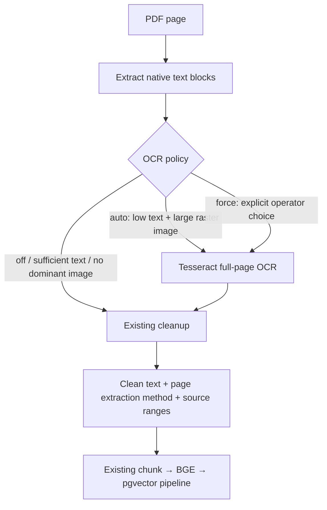

# Selective OCR: scanned PDF ingestion

OCR (optical character recognition) converts pixels into text. It is an optional
extraction route, not another embedding model or a new Kafka architecture.

## Routing and implementation



Auto mode defaults to fewer than 32 native alphanumeric characters and a single
visible image covering at least 60% of the page. Blank pages and small logos do
not trigger it. Selected pages are fully recognized to avoid appending duplicate
native text to an OCR layer. Native digital pages keep their original route.

`Page.get_textpage_ocr` uses Tesseract through PyMuPDF. The returned TextPage is
reused for positioned text extraction, then existing cleaning/ordering applies.
There is no paid API and no second Python OCR wrapper dependency. Recognition
uses the configured language data. A standard Tesseract installation supplies
that data; an explicit tessdata directory also works with the verified PyMuPDF
runtime. See [PyMuPDF OCR API](https://pymupdf.readthedocs.io/en/latest/page.html#Page.get_textpage_ocr).

## Install and enable

macOS, if Tesseract is not already installed:

```bash
brew install tesseract
```

The API Dockerfile supplies English language data; CI installs Tesseract/English
data for actual OCR tests. Additional language packs must be installed explicitly.
The modified Docker image still requires an operator build; changing its recipe
does not modify a running image.

Keep existing `.env` values. Set only the OCR options you intend to enable:

```dotenv
CHUNKFORGE_OCR_MODE=auto
CHUNKFORGE_OCR_LANGUAGE=eng
CHUNKFORGE_OCR_DPI=200
# Optional if language data is not discoverable:
# CHUNKFORGE_OCR_TESSDATA=/absolute/path/to/tessdata
```

The code/example default is `off` to avoid silently reprocessing a known corpus.
Restart long-running workers after settings changes. Kafka and batch use the same
options; Kafka payloads need not change.

For a bounded folder, use explicit CLI overrides rather than the entire corpus:

```bash
.venv/bin/python -m chunkforge.ingestion.parser \
  --raw-dir /path/to/scanned-pdfs --processed-dir /path/to/processed-scans \
  --ocr-mode auto --ocr-language eng --ocr-dpi 200
```

Use `--ocr-mode force` only when auto detection misses a known scanned page.
Force recognizes all pages, including digital/blank pages, and can change clean
digital text. It is not the recommended corpus default.

## Limits and failure behavior

- Default maximum: 50 recognized pages per document and 20 million rendered pixels
  per page; configurable through `CHUNKFORGE_OCR_MAX_PAGES` and
  `CHUNKFORGE_OCR_MAX_PIXELS`. These bound work, not wall-clock completion time.
- Missing language packs/engine failures raise `OcrUnavailable`, a RuntimeError.
  Batch records the failure; Kafka does not commit successful processing or
  classify a missing engine as poison input.
- Auto can miss tiled scans, vector-only simulated letters, small scanned regions
  and scanned text on pages with substantial native text. Force can help some of
  those cases but does not repair all layouts.
- No implemented deskew, handwriting guarantee, language auto-detection, semantic
  table reconstruction or OCR-confidence/character-error-rate benchmark.
- Recognized text can contain mistakes. Review critical numbers/names against
  the source; downstream citations do not establish OCR accuracy.

## Cache identity and re-embedding

Processed sidecars now contain parser version, OCR options, PyMuPDF version,
available language-pack hashes, source hash, clean-output hash and per-page
`extraction_method` (`native` or `ocr`). A short native caption cannot masquerade
as successful extraction of the image body. Image-description placeholder blocks
are excluded from searchable text.

Cache reuse checks source/output identity and extraction settings, not only
timestamps. Old version-1.0 sidecars will be refreshed when explicitly passed to
the parser. The implementation does not automatically rerun the existing corpus.

Indexing still fingerprints clean text, chunk configuration and model identity:
unchanged text/config/model skips embedding; changed text replaces the affected
document/strategy transactionally. There is no page-level partial re-embedding
or global five-strategy transaction. The original source PDF is never rewritten.

## Reproduce the five-document acceptance lab

These are generated synthetic PDFs, not downloaded papers or a representative OCR
benchmark. The lab uses ignored `.learning/ocr/` and an optional separate database
table, never the main corpus table.

| Fixture | Pages | Expected OCR pages | Purpose |
|---|---:|---:|---|
| `01_digital.pdf` | 1 | 0 | Preserve native text without OCR |
| `02_scanned.pdf` | 1 | 1 | Recover an image-only page |
| `03_mixed.pdf` | 2 | 1 | Keep digital page; recognize scanned page |
| `04_sparse_native.pdf` | 1 | 1 | Recover scan body despite native caption |
| `05_scan_blank_scan.pdf` | 3 | 2 | Keep blank page empty and source offsets valid |

```bash
# Tesseract English data discoverable through your installation:
.venv/bin/python -m chunkforge.ingestion.ocr_demo

# Or pass an existing directory containing eng.traineddata:
.venv/bin/python -m chunkforge.ingestion.ocr_demo --tessdata /path/to/tessdata

# Real BGE + pgvector, all five strategies, isolated retained table:
.venv/bin/python -m chunkforge.ingestion.ocr_demo --tessdata /path/to/tessdata --index
```

The lab verifies phrases recovered by real OCR, extraction provenance and blank
page spans. It repeats batch parsing and checks five unchanged outputs. With
`--index`, it indexes only the five known fixtures, repeats indexing to verify
unchanged outcomes, runs a real vector query for scanned Kafka instructions and
compares main-corpus counts before/after. Existing non-fixture PDF files are not
overwritten. Do not run corpus writers concurrently with this count-comparison lab.

Inspect:

```text
.learning/ocr/raw/                 five original PDFs
.learning/ocr/processed/           text and metadata sidecars
.learning/ocr/verification.json    actual extraction/indexing results
chunkforge_ocr_demo               isolated vector records, if --index was run
chunkforge_ocr_demo_runs          isolated completion markers
```

```sql
SELECT strategy,count(*) AS documents,sum(chunk_count) AS chunks
FROM chunkforge_ocr_demo_runs GROUP BY strategy ORDER BY strategy;

SELECT doc_id,strategy,chunk_index,text,vector_dims(embedding)
FROM chunkforge_ocr_demo WHERE doc_id='03_mixed' AND strategy='recursive';
```

For an optional isolated API demo, start another port without replacing the main
API. This makes the standard endpoints search only the five demo documents:

```bash
CHUNKFORGE_VECTOR_TABLE=chunkforge_ocr_demo .venv/bin/uvicorn \
  chunkforge.api.main:app --host 127.0.0.1 --port 8001
```

Open `http://localhost:8001/docs` and POST `/search` with query
`When should Kafka consumers commit offsets?` and strategy `recursive`.
The regular API's Redis dependency/model setup still applies; this is not a new
upload interface or an automatic switch of the main UI. Stop the demo with Ctrl-C.

## Run tests

```bash
# With a standard installation, English data is discovered automatically:
.venv/bin/python -m pytest tests/test_ocr.py -v

# Or explicitly select the test language directory:
CHUNKFORGE_TEST_TESSDATA=/path/to/tessdata .venv/bin/python -m pytest tests/test_ocr.py -v
```

Actual recognition checks skip when no OCR language data is available. Explicitly
configured missing test data fails rather than silently skipping. Unit tests also
cover native bypass, small-logo rejection, missing-language errors, resource
limits, policy/source/output invalidation and offset integrity. CI installs the
language data so recognition tests execute there.
