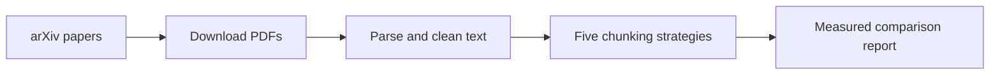

# Run and test ChunkForge

## Current implementation

Phases 0–2 implement local infrastructure, a health API, PDF ingestion and five
chunking strategies. Phase 3 adds a verified one-paper vector-indexing pilot;
the full 200-paper vector index remains pending. Search API routes, generated
answers and the Angular UI are future work. `/health` reports API liveness.



The FastAPI health endpoint is a separate runnable service. PostgreSQL, Redis,
Kafka and Ollama are ready for later integrations. The current batch chunking
workflow does not require Docker. Semantic and late chunking use local BGE
inference, not Ollama.

## 1. Open the project

Run commands from this directory in VS Code's terminal:

```bash
cd /Users/sreecharanreddymadireddy/Documents/GENAI/chunkforge
make help
```

On another machine, use the location where you cloned the repository instead.
`make` targets explicitly select the project interpreter; activating the virtual
environment is optional:

```bash
source .venv/bin/activate
```

## 2. Install dependencies

```bash
make setup
```

This synchronizes the project environment with development, API, ingestion and
tokenization dependencies. Run it after cloning or dependency changes. Prefer
this command over bare `uv sync`, which does not select these extras.

For a fresh clone only, create a local environment file if none exists:

```bash
test -f .env || cp .env.example .env
```

If host port 5432 is occupied, set `POSTGRES_PORT=5433` in `.env` and make the
host-run application's `CHUNKFORGE_POSTGRES_DSN` use `localhost:5433`. The
PostgreSQL container still listens internally on 5432. Keep `.env` private.

## 3. Run infrastructure

Open Docker Desktop and wait for its engine to be ready, then:

```bash
make docker-up
make docker-ps
```

All four services should show healthy. On the current development machine:

| Service | Host connection | Container's native port |
|---|---|---:|
| PostgreSQL | localhost:5433 | 5432 |
| Redis | localhost:6379 | 6379 |
| Kafka | localhost:9092 | 9092 |
| Ollama | localhost:11434 | 11434 |

The repository defaults to host PostgreSQL port 5432; the local `.env` overrides
it to 5433. Kafka currently advertises a host-run client endpoint. Container
producer/consumer listeners will be configured with the event-ingestion phase.

Useful checks:

```bash
docker compose exec redis redis-cli ping
docker compose exec postgres pg_isready -U chunkforge -d chunkforge
docker compose exec postgres psql -U chunkforge -d chunkforge -c "SELECT extversion FROM pg_extension WHERE extname = 'vector';"
docker compose exec kafka /opt/kafka/bin/kafka-topics.sh --bootstrap-server localhost:9092 --list
curl http://localhost:11434/api/tags
```

These commands use the default local database user and database. Redis should
return `PONG`; PostgreSQL should accept connections and show a vector extension
version. An empty Kafka topic list or empty Ollama model list is valid at this
stage: a healthy service need not contain topics or model weights yet.

## 4. Start the API

In terminal A:

```bash
make api
```

Keep this terminal running. In terminal B:

```bash
cd /Users/sreecharanreddymadireddy/Documents/GENAI/chunkforge
curl -i http://localhost:8000/health
```

Expected body:

```json
{"status":"ok","service":"chunkforge-api","version":"0.1.0"}
```

Open <http://localhost:8000/docs>. Expand `GET /health`, choose **Try it out**,
then **Execute**. Expect HTTP 200. `/search` and `/ask` do not exist yet.

Stop the API with Ctrl+C in terminal A. If port 8000 is occupied, inspect it:

```bash
lsof -nP -iTCP:8000 -sTCP:LISTEN
```

Stop only the process you recognize, or use another port for a temporary run:

```bash
.venv/bin/uvicorn chunkforge.api.main:app --reload --host 127.0.0.1 --port 8001
```

## 5. Run automated tests

```bash
make check
```

This runs Ruff lint, strict mypy checks and pytest with coverage. The Phase 3
pilot has 32 passing tests and 88% coverage with integration enabled; without
the integration flag, the database test is skipped. Five existing
PyMuPDF SWIG deprecation warnings are reported separately from test failures.

Individual checks:

```bash
make lint
make typecheck
make test
.venv/bin/python -m pytest tests/test_chunking.py -v
.venv/bin/python -m pytest tests/test_chunking.py -k late -v
.venv/bin/python -m pytest tests/test_ingestion.py -v
.venv/bin/python -m pytest tests/test_api.py -v
```

Tests use deterministic encoder fixtures and need no Docker services or model
weights. The first tiktoken load may download its public vocabulary. Passing
fixture tests is separate from the real-model corpus comparison below.

`make format` reformats source files; it changes files rather than only checking.

## 6. Test ingestion

The existing corpus already contains 200 downloaded and processed papers. Reuse
it for Phase 2 rather than downloading again on every run.

For an isolated five-paper smoke test that preserves the main corpus:

```bash
.venv/bin/python -m chunkforge.ingestion.downloader --max-results 5 --raw-dir data/raw/smoke
.venv/bin/python -m chunkforge.ingestion.parser --raw-dir data/raw/smoke --processed-dir data/processed/smoke
```

Both destinations are ignored by Git. The downloader enforces the three-second
request interval. The parser prints its measured document statistics. For the
default complete 200-paper pipeline:

```bash
make ingest
```

Existing valid files are reused. A later run fetches current arXiv metadata, so
the selected paper IDs can change; it is not an immutable corpus snapshot.
Do not add `--overwrite` unless you intend to regenerate existing outputs.

## 7. Test the real chunking lab

```bash
make chunk-compare
```

It installs the ML extra, loads BGE-small (downloaded on the first run), and
processes the first five sorted `.txt` files in `data/processed`. All complete
documents are processed. CPU speed, model download and file availability affect
runtime. Docker and Ollama are not involved in this command.

The command validates chunk source spans, complete character coverage and core
token budgets. It prints one result per document and strategy, then writes:

- `eval/CHUNKING_RESULTS.md`: human-readable table and interpretation.
- `eval/CHUNKING_RESULTS.json`: source hashes, model revision and configuration.

For a one-paper real-model smoke test:

```bash
.venv-bootstrap/bin/uv run --extra dev --extra api --extra ingestion --extra chunking --extra ml python -m chunkforge.chunking.compare --documents 1 --output data/processed/chunking-smoke.md
```

This writes the smoke Markdown and JSON under the ignored processed-data folder,
leaving the checked-in five-paper report intact. Chunk counts do not establish
which strategy retrieves the best evidence. Late pooling has bounded BGE
passage context and a smaller core budget; sentence-window anchors carry
separate surrounding context.

## 8. Vector indexing and search pilot

PostgreSQL must be running. Index one full paper across all five strategies:

```bash
make embed ARGS='--max-documents 1 --query "How does DivOPD choose turns when training agents?"'
```

This is a real persistence/inference run, not a mocked test. It creates
`chunkforge_chunks` and `chunkforge_chunks_runs`, stores complete strategy runs
transactionally and creates partial HNSW indexes. It prints per-strategy counts,
ranked query results and warm search median latency over 20 repetitions.
The timings include database connection setup and exclude query embedding.

Run the full 200-paper corpus or query an existing index:

```bash
make embed
make embed ARGS='--search-only --query "How does batch selection work?"'
CHUNKFORGE_RUN_PGVECTOR_TESTS=1 make check
```

The full corpus job is resumable and can take substantial CPU time. A pilot
does not establish 200-paper completion or production performance. The local
database tests create and remove only their own uniquely named test tables.

## 9. Logs and shutdown

```bash
make docker-logs
docker compose logs --tail=100 postgres
docker compose logs --tail=100 kafka
```

Ctrl+C stops following logs. Stop the API in its terminal, then stop the stack:

```bash
make docker-down
```

Named volumes remain available for the next startup. Avoid `docker compose down
-v` when you want to retain database, broker, Redis and Ollama state.

## 10. Daily workflow

1. Open the project directory.
2. Run `make setup` when dependencies changed.
3. Run `make check` for code verification.
4. Use `make api` and `/docs` for API checks.
5. Use `make chunk-compare` for the real chunking experiment.
6. Inspect `git status` and `git diff` before selecting files for a commit.

GitHub reflects the commits pushed to the remote branch. Review `git status`
and the selected diff before committing and publishing a change.

## Next development gate

Phase 3 is in progress. Review normalization, cosine similarity, model/pooling
identity, transactional persistence and the HNSW trade-off. The remaining gate
is indexing all 200 papers and checking wider-corpus queries and timings before
advancing to hybrid retrieval. `make eval` and `make ui` target future modules.
