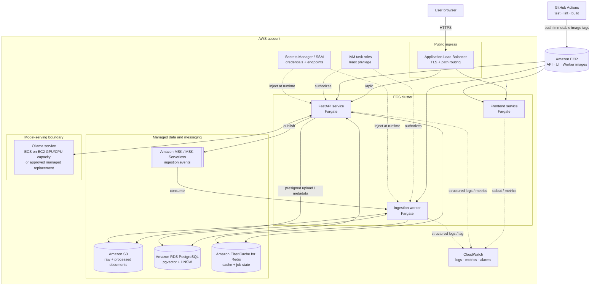

# AWS Deployment Architecture

**Status:** Target design for Phase 11. This document defines the deployment
direction; no AWS resources or credentials are created during Phase 0.

## Why each compute choice exists

| Workload | Placement | Reason |
|---|---|---|
| Angular web server | ECS Fargate | Stateless, small, independently scalable |
| FastAPI | ECS Fargate | Stateless request handling with managed task lifecycle |
| Kafka consumer worker | ECS Fargate | Independent scaling based on consumer lag |
| PostgreSQL/pgvector | RDS PostgreSQL | Managed backups, patching, storage, Multi-AZ options |
| Redis | ElastiCache | Managed in-memory service with replication/failover options |
| Kafka | MSK or MSK Serverless | Durable managed broker rather than stateful broker tasks |
| Ollama | ECS on EC2 capacity | Fargate does not provide the GPU profile typically needed for responsive local-model inference |

For a low-cost portfolio deployment, MSK and GPU instances may be too expensive.
Phase 11 must document a cost-controlled option, such as scheduled resources, a
small CPU model for demonstrations, or replacing self-hosted inference with an
approved managed endpoint. The diagram must be updated to match the option actually
deployed.

## Network boundaries

- Only the load balancer is public.
- ECS tasks, RDS, ElastiCache, MSK, and model serving use private subnets.
- Security groups allow only required service-to-service ports.
- RDS and Redis are never exposed to the internet.
- NAT or private endpoints provide controlled access to ECR, S3, logs, and model artifacts.

## Data lifecycle

1. The API stores raw uploads in S3 and publishes a small event containing the S3 key.
2. The worker reads the object, writes processed artifacts back to S3, and persists
   searchable chunks and vectors to RDS.
3. Redis holds reconstructable cache entries and job status with TTLs.
4. RDS automated backups protect metadata and vectors; S3 versioning protects documents.

## Secrets and identity

- ECS task roles provide AWS API access without static access keys.
- Database passwords and non-AWS secrets come from Secrets Manager or SSM Parameter Store.
- GitHub Actions uses short-lived OIDC federation instead of stored AWS user keys.
- The frontend receives no database, Redis, Kafka, or model credentials.

## Observability

CloudWatch receives structured JSON logs containing `correlation_id`, `job_id`,
route, latency, dependency, retry count, fallback mode, and outcome. Required alarms
include API 5xx rate, target health, p95 latency, worker crash loops, Kafka consumer
lag, RDS capacity/connections, Redis evictions, and model timeout rate.

## Scaling story

- Scale API tasks on request count, CPU, and latency.
- Scale worker tasks primarily on Kafka consumer lag, bounded by partition count.
- Scale model serving separately because its memory/GPU profile differs from the API.
- At very large corpus size, partition ingestion, tune HNSW and RDS resources, and
  evaluate a dedicated vector engine only when measured limits justify it.

## Code and configuration map

- `Dockerfile.api` — API container image.
- future frontend Dockerfile — static Angular production build.
- `aws/` — task definitions, IAM policy, log configuration, and deployment guide.
- `chunkforge/config.py` — environment-driven endpoints and model names.
- `.github/workflows/ci.yml` — quality checks; image build/deploy extension in Phase 11.

## Design rationale

**Why not run PostgreSQL or Kafka in Fargate tasks?** They are stateful systems with
storage, replication, failover, and maintenance requirements. Managed services make
those operational responsibilities explicit and reduce the chance of data loss.

**Why scale the worker separately from the API?** API load follows user traffic;
worker load follows ingestion backlog. Coupling them wastes resources and prevents
Kafka lag from being handled independently.
