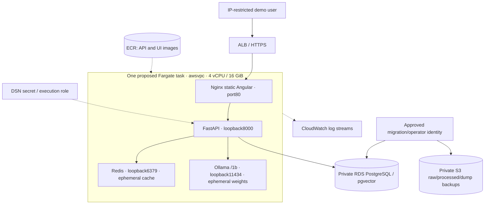

# AWS target — executable kit, not a deployed system

**Not deployed.** Account-specific task/IAM JSON is rendered by `aws/render.py`.
Use [DEPLOY.md](../../aws/DEPLOY.md) for provisioning, migration, image builds,
verification, rollback and cost-aware teardown. Local validation isn't cloud execution.

Only frontend80 is reachable from ALB SG. RDS5432 accepts task/migration SGs.
No public database, Redis, API-port or model-port ingress. Private tasks need
outbound paths for image/model downloads. API's required Kafka setting is unused
in query serving; no cloud broker/worker is deployed by this v1 kit.

S3 is an operator-managed corpus backup, not an automatically integrated upload
pipeline. No MSK, ElastiCache, presigned upload endpoint, API→Kafka publishing,
OIDC deployment workflow or structured distributed tracing is claimed. Cloud
Redis/model cache are reconstructable; RDS/S3 durability requires configured and
tested backup/restore policies. Current API liveness isn't dependency readiness.

Co-location avoids service discovery in the demo but couples scaling/failure.
Separate services, shared lexical/model serving, durable model artifacts and
object-version ingestion are future work with explicit IAM/network requirements.
Record a real URL only after the operator completes the deployment and smoke test.
