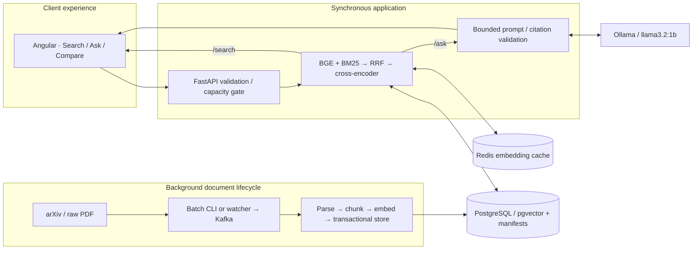

# Current end-to-end architecture

Batch ingestion bypasses Kafka; new-file ingestion uses it. Neither path runs
through a public upload API. Queries never enter Kafka. Redis stores vectors,
not completed answers; PostgreSQL is the durable evidence source.

Verified runtime is host API/UI plus Docker dependencies. All75selected documents
are indexed across5strategies. Actual generation and replay smoke checks are in
`eval/PHASES_6_TO_10.md`; the10seed/60document retrieval pilot is not a final
independent benchmark. AWS remains operator-execution pending.

[Visual phase atlas](../PROJECT_ATLAS.html) · [Every stage's records](../END_TO_END_GUIDE.md)
· [API sequence](../API_FLOWS.md) · [Current deployment inventory](../OPERATIONS.md).
