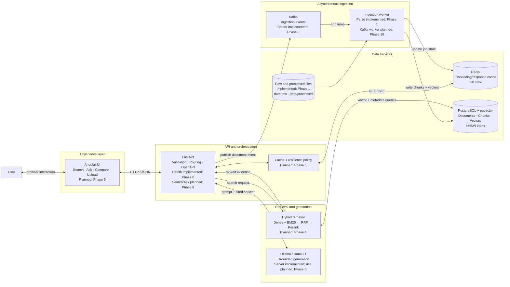

# End-to-End Functional Architecture

**Status:** Phase 0 infrastructure and Phase 1 batch download/parsing are
implemented. Angular, event-driven ingestion, chunking/embedding, retrieval,
generation, and resilience are the target architecture for later phases.

## Request walkthroughs

### Search or ask

1. Angular sends a typed request to FastAPI.
2. The resilience policy checks Redis for a reusable result or embedding.
3. On a miss, hybrid retrieval queries PostgreSQL/pgvector and the BM25 index.
4. The retrieval pipeline fuses and reranks candidates.
5. `/search` returns ranked chunks. `/ask` additionally sends evidence to Ollama.
6. FastAPI returns the answer and citations and may cache the result.

### Document ingestion

1. A document is placed in `data/raw` or submitted through the future API/UI.
2. FastAPI or the directory producer publishes an ingestion event to Kafka.
3. A consumer parses, cleans, chunks, and embeds the document.
4. PostgreSQL stores chunks, metadata, strategies, and vectors.
5. Redis stores short-lived job status; the UI can observe completion.

## Component ownership

| Component | Responsibility | Code/configuration |
|---|---|---|
| FastAPI | API contracts and orchestration | `chunkforge/api/main.py` |
| Typed configuration | Environment validation | `chunkforge/config.py` |
| Batch acquisition | Rate-limited arXiv download and manifest | `chunkforge/ingestion/downloader.py` |
| PDF parsing | Clean text, provenance sidecars, and statistics | `chunkforge/ingestion/parser.py` |
| Kafka pipeline | Producer/consumer ingestion | `chunkforge/ingestion/kafka_pipeline.py` (Phase 10) |
| Retrieval pipeline | Dense + sparse fusion and reranking | `chunkforge/retrieval/pipeline.py` (Phase 4) |
| Generation | Visible prompt and Ollama client | `chunkforge/generation/rag.py` (Phase 6) |
| Redis resilience | Cache and degraded-operation support | `chunkforge/resilience/` (Phase 5) |
| Vector store | Schema, HNSW, cosine search | `chunkforge/store/pgvector_store.py` (Phase 3) |
| Local dependencies | Development services | `docker-compose.yml` |

## Failure boundaries

- Redis failure must not corrupt PostgreSQL; retrieval can continue without cache.
- Kafka downtime blocks new asynchronous ingestion but not searches over existing data.
- Ollama downtime blocks answer generation but `/search` can still return evidence.
- PostgreSQL downtime blocks retrieval and persistence and must produce a clear
  dependency-health error rather than a fabricated answer.

## Design rationale

**Why is Kafka not in the search path?** Search is latency-sensitive and already
has a direct request/response contract. Kafka is valuable for long-running,
replayable ingestion work, where decoupling and backpressure matter more than an
immediate response.

**Why both Redis and PostgreSQL?** PostgreSQL is durable truth. Redis stores
reconstructable, short-lived values that reduce latency or communicate job state.
