# Document Ingestion Pipeline

**Status:** The rate-limited arXiv downloader and batch PDF parser are implemented
and tested in Phase 1. Kafka, PostgreSQL, and Redis servers exist from Phase 0.
Chunking, embedding/vector persistence, and the Kafka producer/consumer remain the
target design for Phases 2, 3, and 10.

```mermaid
flowchart LR
    SOURCE["Document source<br/>arXiv downloader · PDF drop · future upload"]
    RAW[("Raw PDF<br/>data/raw")]
    PRODUCER["Ingestion producer<br/>detect + validate + assign document_id"]
    TOPIC[["Kafka topic<br/>ingestion.events"]]
    CONSUMER["Consumer worker<br/>idempotency + status"]
    PARSER["PyMuPDF parser<br/>extract + clean text"]
    PROCESSED[("Clean text<br/>data/processed")]
    CHUNKERS["Chunking lab<br/>fixed · recursive · semantic<br/>sentence-window · late"]
    EMBEDDER["BGE embedder<br/>batch + normalize"]
    CACHE[("Redis<br/>embedding cache + job state")]
    STORE[("PostgreSQL + pgvector<br/>chunks + metadata + vectors")]

    SOURCE --> |"download or copy"| RAW
    RAW --> PRODUCER
    PRODUCER --> |"ProcessingRequested"| TOPIC
    TOPIC --> |"consumer group"| CONSUMER
    CONSUMER --> PARSER
    PARSER --> PROCESSED
    PROCESSED --> CHUNKERS
    CHUNKERS --> |"chunk text"| EMBEDDER
    EMBEDDER <--> |"hash lookup / cached vector"| CACHE
    EMBEDDER --> |"normalized embeddings"| STORE
    CONSUMER --> |"PENDING · RUNNING · COMPLETED · FAILED"| CACHE
```



## Event contract

The event should carry references and identity, not a large PDF payload:

```json
{
  "event_type": "ProcessingRequested",
  "event_version": 1,
  "event_id": "uuid",
  "document_id": "stable-document-id",
  "source_path": "data/raw/paper.pdf",
  "content_sha256": "hex-digest",
  "requested_strategies": ["fixed", "recursive", "semantic"],
  "created_at": "ISO-8601 timestamp",
  "correlation_id": "uuid"
}
```

`event_id` identifies one delivery. `document_id` identifies the logical document.
`content_sha256` supports deduplication and embedding-cache keys. `event_version`
allows the producer and consumer to evolve independently.

## Processing lifecycle

1. Download sequentially, validate the PDF signature, and compute its content hash.
2. Publish the event; do not perform expensive parsing on the API thread.
3. The consumer claims the event and records `RUNNING` state.
4. Parse pages, remove repeated headers/footers, repair hyphenation, and write clean text.
5. Run every selected chunker while preserving document and character offsets.
6. Reuse cached embeddings when `(model, normalized_text_hash)` matches.
7. Generate missing vectors in batches and L2-normalize them.
8. Upsert document, chunk, strategy, and vector records in a transaction.
9. Record `COMPLETED`; acknowledge the Kafka event only after durable persistence.

## Delivery and idempotency

Kafka provides at-least-once delivery in this design. A consumer can receive an
event again after a crash. Database uniqueness on document version, strategy, and
chunk index makes replay safe. “Exactly once” is achieved at the business level
through idempotent writes, not by assuming the broker never redelivers.

## Failure scenarios

| Failure | Expected behavior |
|---|---|
| Consumer stops | Kafka retains events; lag rises; processing resumes after restart |
| Parser rejects a corrupt PDF | Mark job `FAILED` with a safe reason; do not store partial chunks |
| Embedding model is temporarily unavailable | Retry with bounded exponential backoff and jitter |
| PostgreSQL write fails | Roll back the document transaction and do not acknowledge the event |
| Duplicate event | Detect existing content/version and perform an idempotent no-op or upsert |

## Code map

- `chunkforge/ingestion/downloader.py` — Phase 1 source acquisition.
- `chunkforge/ingestion/parser.py` — Phase 1 PDF cleaning.
- `chunkforge/chunking/` — Phase 2 strategy implementations.
- `chunkforge/embeddings/embedder.py` — Phase 3 batching and normalization.
- `chunkforge/store/pgvector_store.py` — Phase 3 transactional persistence.
- `chunkforge/ingestion/kafka_pipeline.py` — Phase 10 producer and consumer.
- `chunkforge/resilience/cache.py` — Phase 5 embedding cache and job state.

The current batch command runs acquisition and parsing synchronously with
`make ingest`. Phase 10 adds Kafka around the same tested parser contract; it does
not replace the parser or make Kafka part of synchronous search.

## Design rationale

**Why acknowledge Kafka only after the database commit?** Acknowledging first can
lose work if the process crashes before persistence. Committing first may cause a
redelivery, which is safe because writes are idempotent.

**Where does backpressure happen?** Kafka absorbs bursts while consumer throughput
is lower than producer throughput. Consumer lag quantifies that backlog and drives
scaling or operational alerts.
