# Implemented document lifecycle

```mermaid
flowchart LR
    ARXIV["Rate-limited arXiv download"] --> RAW[("Raw PDF + acquisition manifest")]
    RAW --> BATCH["Batch parser / index CLI"]
    RAW --> WATCH["Stable-file watcher / hash"]
    WATCH -->|"acknowledged metadata event"| K["Kafka topic"]
    K --> CONSUMER["Manual-commit consumer"]
    BATCH --> EXTRACT{"Native text / optional OCR routing"}
    CONSUMER --> VERIFY["Validate path/hash/event identity"] --> EXTRACT
    EXTRACT -->|"digital text"| PARSE["Cleanup + page/source provenance"]
    EXTRACT -->|"eligible raster scan; opt-in"| OCR["Bounded Tesseract recognition"] --> PARSE
    PARSE --> CHUNK["Five source-preserving chunk strategies"]
    CHUNK --> EMBED["BGE encode / retained late vectors"]
    EMBED --> PG[("PostgreSQL vectors + run fingerprints")]
    PG -->|"all selected strategies succeed"| COMMIT["Kafka commit next offset"]
    VERIFY -->|"poison payload/source"| DLQ["Acknowledge DLQ then commit input"]
```

The batch CLI doesn't commit Kafka offsets; the final commit arrow belongs only
to the consumer path. Operational exceptions leave offsets uncommitted and exit.
Per-strategy transactions/fingerprints allow completed work to skip on replay;
this is at-least-once, not an atomic PostgreSQL/Kafka transaction.

First watcher startup baselines existing PDFs; explicitly opt in before enqueuing
the entire raw directory. Events reference shared relative file paths, not PDF
bytes. Worker-side embedding currently doesn't use the Redis query cache. No
upload endpoint, automatic S3 ingestion or Redis job state is implemented.

OCR is opt-in through shared batch/worker settings. Auto mode recognizes low-text
pages dominated by a large raster image; force mode is an explicit whole-page
choice. Missing language data and resource-budget failures are operational worker
errors, not successful empty ingestion. See [OCR boundaries and acceptance lab](../OCR.md).

See [live replay evidence](../../eval/PHASES_6_TO_10.md) and
[independent operation/debug commands](../OPERATIONS.md).
