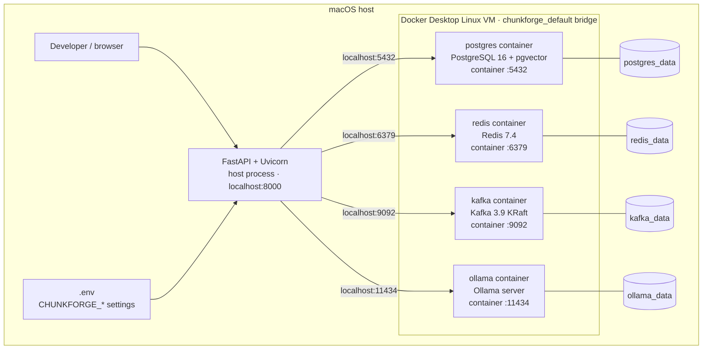
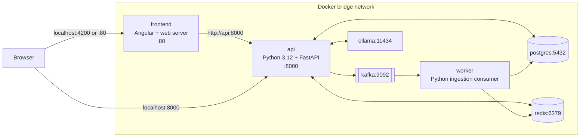

# Local Docker Topology

**Status:** Implemented in Phase 0 for PostgreSQL, Redis, Kafka, and Ollama. The
FastAPI image is implemented and tested, but FastAPI is not yet a service in
`docker-compose.yml`. Angular is planned for Phase 9.

## Current Phase 0 topology



Published host ports can be overridden through Compose variables. For example,
if host port 5432 is occupied, `POSTGRES_PORT=5433` publishes `5433 → 5432`, and
the host-run API must use `localhost:5433`.

## Target fully containerized topology



Inside the bridge network, Compose service names are DNS names. Containers use
`postgres:5432`, `redis:6379`, `kafka:9092`, and `ollama:11434`; they must not use
`localhost` for another container. Inside the API container, `localhost` means the
API container itself.

## Port and connection matrix

| Dependency | Host-run FastAPI | Containerized FastAPI |
|---|---|---|
| PostgreSQL | `postgresql://...@localhost:${POSTGRES_PORT}/chunkforge` | `postgresql://...@postgres:5432/chunkforge` |
| Redis | `redis://localhost:${REDIS_PORT}/0` | `redis://redis:6379/0` |
| Kafka | `localhost:${KAFKA_PORT}` | `kafka:9092` |
| Ollama | `http://localhost:${OLLAMA_PORT}` | `http://ollama:11434` |

## Important Kafka listener constraint

The current broker advertises `localhost:9092`, which is correct for a host-run
client. A future containerized API/worker requires separate internal and external
listeners so Kafka can advertise `kafka:9092` to containers and `localhost:<port>`
to host clients. Port publishing alone does not fix broker-advertised addresses.

## Image and file ownership

`Dockerfile.api` builds the API with two Python stages:

1. A builder based on `python:3.12-slim` installs the locked environment using `uv`.
2. A clean `python:3.12-slim` runtime receives `.venv` and source code, then runs
   Uvicorn as the unprivileged `chunkforge` user.

The host does not need Python to run this image because the Python interpreter and
libraries are inside the image. Host Python is currently needed only for the
host-based development workflow (`make setup`, tests, and `make api`).

## Persistence and lifecycle

- `docker compose down` removes containers and the bridge network but retains named volumes.
- `docker compose down --volumes` deletes persistent local data and is intentionally not a Make target.
- Recreating a container does not delete its named volume.
- `ollama_data` preserves downloaded model weights.

## Verification commands

```bash
make docker-up
make docker-ps
docker compose exec postgres psql -U chunkforge -d chunkforge -c '\dx vector'
docker compose exec redis redis-cli ping
docker compose exec kafka /opt/kafka/bin/kafka-topics.sh --bootstrap-server localhost:9092 --list
docker compose exec ollama ollama list
```

## Design rationale

**What does `5432:5432` mean?** The left port is on macOS; the right port is in the
container. Docker forwards host traffic to the isolated container process.

**Why do container connection strings use service names?** Compose provides DNS
inside its bridge network. Service discovery is independent of dynamically assigned
container IP addresses.

