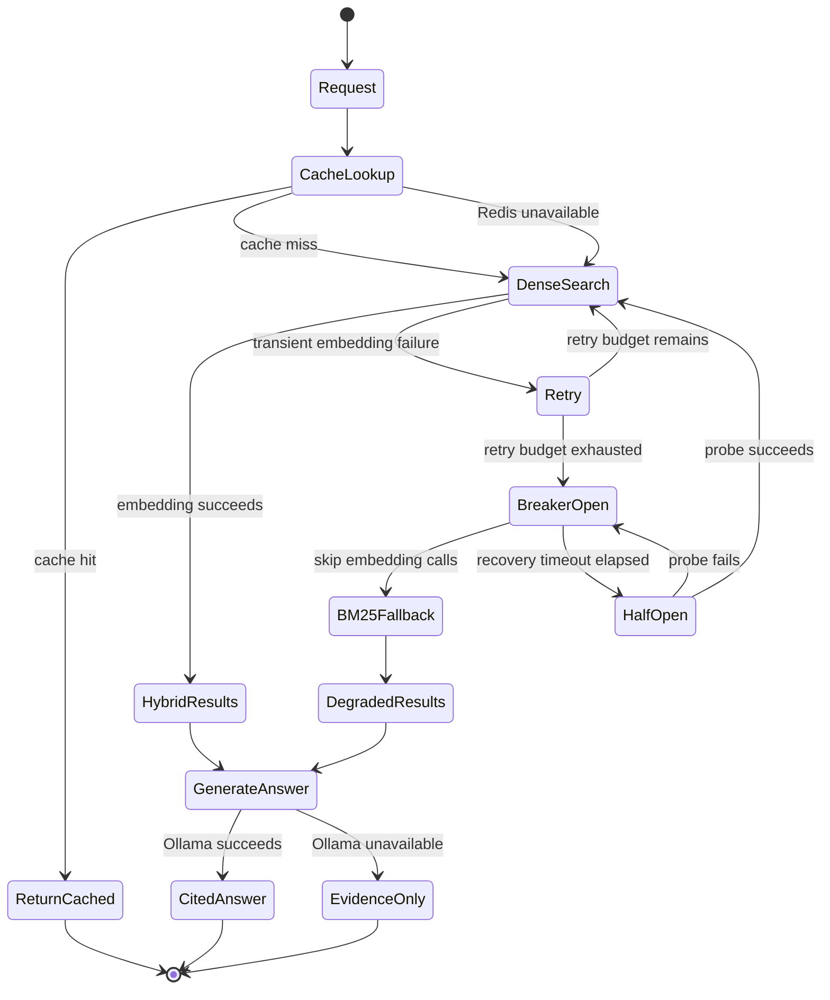

# Resilience and Degraded Operation

**Status:** Target design for Phase 5. Redis is running in Phase 0, but the cache,
retry, circuit-breaker, and fallback modules are not implemented yet.



## Pattern responsibilities

| Pattern | Solves | Does not solve |
|---|---|---|
| Cache | Repeated expensive embedding or answer work | Correctness of stale data by itself |
| Retry | Short transient failures | Permanent failures or invalid requests |
| Exponential backoff | Reduces repeated pressure during failure | Coordinated retry spikes without jitter |
| Jitter | Spreads retries across callers | Dependency recovery by itself |
| Circuit breaker | Stops calls to a repeatedly failing dependency | The fallback result itself |
| Fallback | Preserves useful reduced functionality | Full semantic-search quality |

## Cache keys and invalidation

```text
embedding:{model_name}:{normalized_text_sha256}
search:{retrieval_version}:{strategy}:{normalized_query_sha256}
answer:{prompt_version}:{corpus_version}:{normalized_query_sha256}
job:{job_id}
```

Model, retrieval, prompt, and corpus versions belong in keys. A deployment can
then invalidate logically by changing a version rather than scanning Redis for
every old key. Redis values are rebuildable; PostgreSQL remains authoritative.

## Retry policy

- Retry only timeouts, connection failures, rate limits, and documented 5xx errors.
- Do not retry validation errors, unsupported file types, or malformed requests.
- Use bounded exponential backoff with random jitter and an overall deadline.
- Log attempt number, dependency, correlation ID, and terminal outcome.

## Circuit-breaker states

- **Closed:** calls flow normally; failures are counted.
- **Open:** calls fail fast and use BM25 fallback.
- **Half-open:** a limited probe determines whether the dependency recovered.

The breaker protects the service and its dependency from a retry storm. It is not
a health check and should not share global state across unrelated dependencies.

## Degraded responses

A degraded result is explicit, not hidden:

```json
{
  "mode": "bm25_fallback",
  "degraded": true,
  "warning": "Semantic embeddings are temporarily unavailable.",
  "results": []
}
```

If Ollama fails after retrieval, return evidence-only search results when the API
contract permits it. Never fabricate a generated answer.

## Code map

- `chunkforge/resilience/cache.py` — Redis cache abstraction and key policy.
- `chunkforge/resilience/retry.py` — bounded backoff and jitter.
- `chunkforge/resilience/breaker.py` — closed/open/half-open state machine.
- `chunkforge/resilience/fallback.py` — BM25-only degraded operation.
- `chunkforge/embeddings/embedder.py` — cache/retry integration point.
- `chunkforge/retrieval/pipeline.py` — fallback and response-mode integration.

## Design rationale

**Why not retry indefinitely?** It increases user latency, multiplies load on an
already failing dependency, and consumes worker capacity. A deadline plus circuit
breaker fails predictably and preserves resources.

**What is safe to cache?** Deterministic embeddings are ideal. Generated answers
need shorter TTLs and versioned keys because their correctness depends on the
prompt, model, and corpus version.

