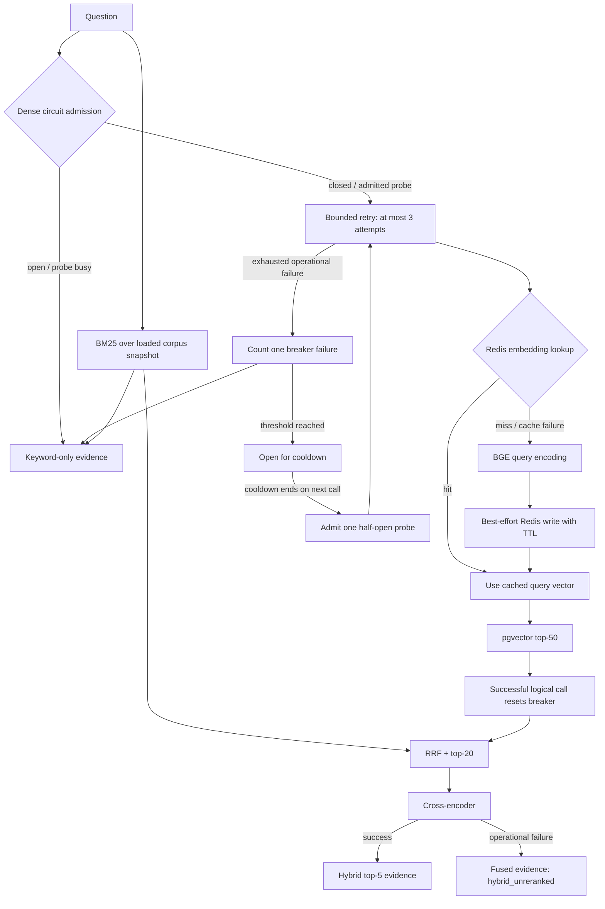

# Resilience and degraded operation

**Status:** Implemented for CLI retrieval. This diagram describes embedding caching,
bounded dense-path retries, a process-local circuit breaker and evidence fallback.
Answer generation and Ollama failure handling are future work.



A cache hit bypasses query inference, **not** vector search, fusion or reranking.
The retry operation includes query embedding and database search. Its exhausted
failure counts once toward the default three-call breaker threshold. A failed
half-open probe reopens immediately; a successful one closes/reset failures.

## Cache policy

Only vectors are cached, not answers, search responses or job state. Keys use
`chunkforge:embedding:v1:<sha256>` over structured model-revision, pooling-role,
dimensions and exact prepared text. Default TTL is one day. Changed input or
identity misses immediately. Redis failures and corrupt entries fail open to
inference; a corrupt provider vector remains a validation error.

## Actual degraded contract

```json
{
  "mode": "bm25_only",
  "reasons": ["dense_circuit_open"],
  "hits": [],
  "dense": [],
  "lexical": [],
  "fused": []
}
```

Lists above are empty only to illustrate the response shape; real keyword matches
populate `hits` and `lexical`. Dense and reranker scores are absent in fallback.
No generated answer is fabricated. A cold process still requires initial model
loading and database snapshot access; this is warm-process graceful degradation.

## Scope

Retryable failures are classified operational Python/model and database connection
exceptions. There is no remote HTTP embedding service or rate-limit handler yet.
Redis has connect/read timeouts; database connection timeout is ten seconds.
Hard inference deadlines, distributed breakers, independent persistent lexical
snapshots and cache single-flight protection are not implemented.

See [full contracts and limitations](../HYBRID_RETRIEVAL.md),
[measured outage/cache results](../../eval/RESILIENCE_RESULTS.md), and
`tests/test_resilience.py` for deterministic state/concurrency tests.
