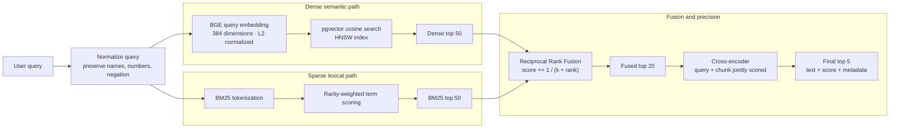
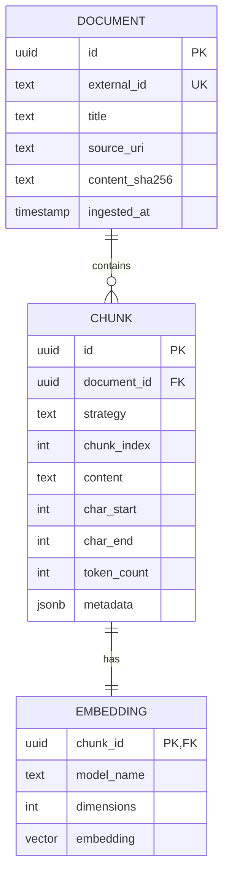

# Retrieval Internals

**Status:** Target design for Phases 3–4 and 7.

## Why the paths are complementary

Dense retrieval compares meaning. It can match “vehicle” with “car” even when the
words differ, but it can underweight exact identifiers, numbers, acronyms, or
negation. BM25 rewards rare exact terms and is strong for model names, error codes,
and quoted phrases, but it does not understand paraphrases. RRF combines rankings
without pretending the incomparable raw scores share one scale.

The cross-encoder is more accurate because it reads the query and candidate
together. It is also slower, so it reranks 20 candidates instead of scanning every
chunk.

## Storage model

The physical Phase 3 schema may combine chunk and embedding columns for simpler
queries. The logical model remains the same: one chunk has stable provenance and
one embedding for a specific model/version. If multiple models are compared later,
embeddings become a separate one-to-many table.

## Ranking contract

Every final result must retain:

- chunk and document identifiers;
- chunking strategy;
- original text and offsets;
- dense rank, BM25 rank, RRF score, and reranker score where available;
- source metadata required to construct citations.

Do not return one ambiguous `score` internally. Score provenance is needed to
debug why a result won.

## Evaluation boundary

`chunkforge/eval/run_eval.py` runs the same query set against every chunking
strategy. `recall@5` measures whether relevant evidence appears in the first five
results. Mean Reciprocal Rank rewards placing the first relevant result earlier.
Latency percentiles are reported separately from quality.

## Failure scenarios

- A missing HNSW index causes a latency regression, not different search semantics.
- A mismatched embedding dimension must fail at startup or insertion, never be
  silently truncated.
- Changing the embedding model invalidates cached vectors and requires re-embedding.
- Reranker failure should return fused results rather than fail the whole search.

## Code map

- `chunkforge/embeddings/embedder.py` — BGE encoding and normalization.
- `chunkforge/store/pgvector_store.py` — schema, HNSW, cosine queries.
- `chunkforge/retrieval/bm25.py` — lexical ranking.
- `chunkforge/retrieval/fusion.py` — hand-written RRF.
- `chunkforge/retrieval/reranker.py` — cross-encoder scoring.
- `chunkforge/retrieval/pipeline.py` — end-to-end retrieval contract.
- `chunkforge/eval/` — quality metrics and benchmark reporting.

## Design rationale

**Why not normalize and add dense and BM25 scores?** Their magnitudes do not have
the same meaning and can change by query. RRF uses rank position, making fusion
stable without score calibration.

**What does HNSW trade?** It trades additional memory and index-build work for
fast approximate nearest-neighbor search with high recall.

