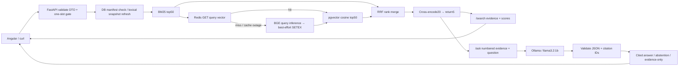

# Implemented question lifecycle

BM25 and dense are complementary rankings over the same compatible source corpus.
Redis contains embeddings, **not answers**. A hit skips inference only. Kafka is
not in this request path. No response cache or job-status store exists.

Dense failure → BM25-only; open breaker → skip dense provider; reranker failure →
fused unreranked evidence; Ollama timeout/invalid reply → evidence-only. Warm
lexical fallback still depends on previously loaded source data. Unsupported
questions can yield canonical abstention. Citations aren't entailment proof.

See [API contracts and exact response examples](../API_FLOWS.md),
[actual generation verification](../../eval/PHASES_6_TO_10.md), and
[full record-by-record journey](../END_TO_END_GUIDE.md).
